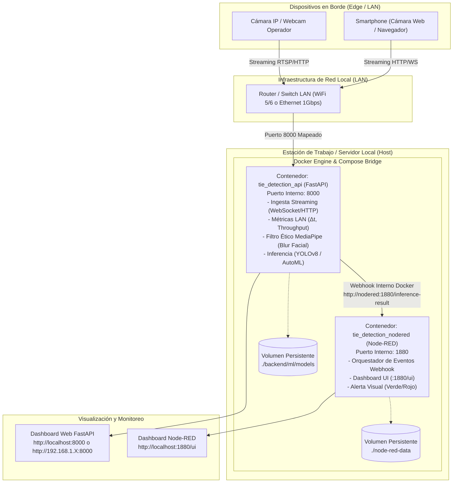
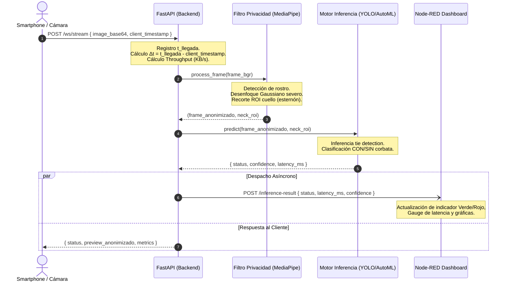

# Topología de Red y Arquitectura de Comunicación Local (LAN)

El sistema opera bajo un esquema **100% On-Premise**, eliminando dependencias de servicios en la nube pública y garantizando el resguardo de la privacidad de los colaboradores y baja latencia de procesamiento.

---

## 1. Diagrama de Topología de Red Física y Lógica

---

## 2. Diagrama de Secuencia: Ciclo de Vida de un Cuadro (Frame Lifecycle)

---

## 3. Parámetros de Red y Rendimiento Medidos

| Métrica | Definición Matemática | Umbral Objetivo Local |
| :--- | :--- | :--- |
| **Latencia de Tránsito ($\Delta t$)** | $\Delta t = t_{\text{llegada}} - t_{\text{captura\_cliente}}$ | $< 50\text{ ms}$ (LAN WiFi/Ethernet) |
| **Tiempo de Inferencia ($t_{\text{inf}}$)** | Tiempo de ejecución del modelo por cuadro | $< 30\text{ ms}$ en CPU |
| **Throughput de Video** | $\text{KB/s} = \frac{\sum \text{Bytes Recibidos}}{\Delta t_{\text{ventana}}}$ | $80 - 250\text{ KB/s}$ por cliente |
| **Tasa de Cuadros (FPS)** | Cuadros procesados y anonimizados por segundo | $15 - 30\text{ FPS}$ |

